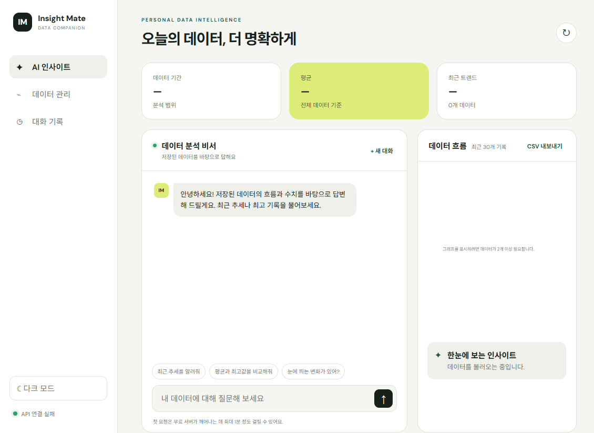
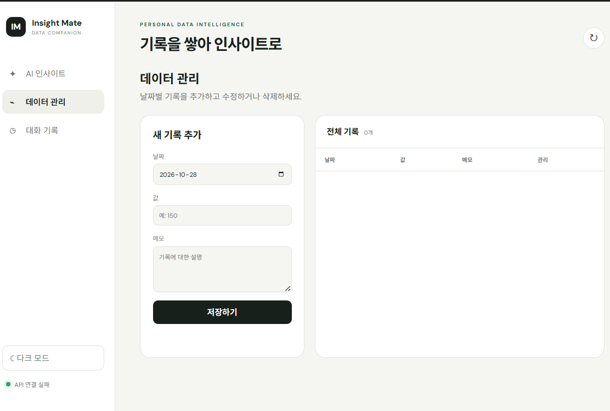

# Insight Mate

내 시계열 데이터를 요약하고 그 맥락을 GPT에 주입해, 사용자의 실제 기록에 근거한 답변을 제공하는 AI 데이터 비서입니다. 기본 예시는 일일 학습 시간(분)이지만 `date`, `value`, `memo` 구조를 유지하면 매출·운동·날씨 등 다른 주제로도 바로 사용할 수 있습니다.

## 화면 미리보기

### AI 인사이트 대시보드



AI 인사이트 화면은 서비스의 중심 대시보드입니다.

- 상단 요약 카드에서 데이터 기간, 전체 평균, 최근 추세와 레코드 수를 확인합니다.
- 왼쪽 채팅 영역에서 저장된 데이터에 관한 자연어 질문을 입력합니다.
- 질문 전에는 자주 쓰는 분석 질문을 추천 문장으로 제공합니다.
- 오른쪽 그래프는 최근 30개 데이터의 흐름을 시각화합니다.
- 현재 데이터를 CSV로 내려받거나 다크 모드로 전환할 수 있습니다.
- Render 무료 서버의 콜드 스타트를 고려한 첫 요청 안내 문구가 표시됩니다.

> 캡처는 백엔드 연결 전 초기 화면입니다. API와 Firestore가 연결되면 요약 카드, 그래프, 인사이트와 채팅 답변이 실제 저장 데이터로 채워집니다.

### 데이터 관리



데이터 관리 화면에서는 분석에 사용할 시계열 원본 데이터를 직접 관리합니다.

- 날짜, 값, 메모를 입력해 새 기록을 저장합니다.
- 저장된 레코드는 날짜, 값, 메모와 함께 표로 표시됩니다.
- 목록에서 기존 데이터를 수정하거나 삭제할 수 있습니다.
- 변경이 완료되면 데이터 목록과 요약 통계가 즉시 갱신됩니다.
- 입력값은 프론트엔드뿐 아니라 FastAPI의 Pydantic 모델에서도 다시 검증합니다.

## 주요 기능

- 시계열 데이터 추가·조회·수정·삭제와 Firestore 저장
- 기간, 개수, 합계, 평균, 최댓값, 최솟값, 최근 추세 자동 계산
- 데이터 요약을 시스템 프롬프트에 넣는 GPT 기반 맞춤형 채팅
- 채팅 자동 저장, 목록 조회, 대화 전체 불러오기·삭제
- 최근 30개 기록 그래프, CSV 내보내기, 다크 모드
- 모바일 대응 UI와 Render 무료 티어 콜드 스타트 안내
- FastAPI Swagger UI 및 Pydantic 입력 검증

## 기술 스택

- Backend: Python 3.10+, FastAPI, Pydantic, Firebase Admin SDK, OpenAI SDK
- Database: Firebase Firestore (`data`, `conversations` 컬렉션)
- Frontend: HTML, CSS, Vanilla JavaScript, Canvas API
- Deploy: Render(Backend), Vercel(Frontend)

## 처리 흐름

```text
브라우저 질문
  → POST /api/chat
  → Firestore data 조회
  → 기간/통계/최근 추세 계산
  → 시스템 프롬프트에 요약 삽입
  → OpenAI API 호출
  → 질문·답변을 conversations에 자동 저장
  → 답변과 최신 요약 반환
```

라우터는 HTTP 요청/응답을, `services`는 요약 및 AI 호출을, `database`는 Firestore 접근을 담당합니다. 이 분리는 저장소나 분석 로직을 바꾸더라도 API 계층에 미치는 영향을 줄입니다. Pydantic 모델은 날짜 형식, 값 범위, 문자열 길이를 API 진입 지점에서 검증해 잘못된 데이터가 DB에 들어가는 것을 막습니다.

## 로컬 실행

### 1. 백엔드

```powershell
python -m venv .venv
.venv\Scripts\Activate.ps1
pip install -r requirements-dev.txt
Copy-Item .env.example .env
uvicorn backend.main:app --reload
```

`.env`에 실제 Firebase/OpenAI 값을 입력해야 합니다. Firebase 없이 화면과 API를 먼저 확인하려면 `USE_MEMORY_DB=true`로 설정할 수 있습니다. 메모리 데이터는 서버 재시작 시 사라지므로 제출 및 배포에서는 사용하지 마세요.

샘플 120개를 넣으려면 백엔드와 동일한 환경에서 다음을 실행합니다.

```powershell
python -m scripts.seed_data
```

API 문서: <http://localhost:8000/docs>

### 2. 프론트엔드

```powershell
$env:API_BASE_URL="http://localhost:8000"
npm run build
python -m http.server 5500 --directory frontend
```

브라우저에서 <http://localhost:5500>에 접속합니다. `file://`로 직접 열면 브라우저 보안 정책 때문에 API 요청이 실패할 수 있습니다.

### 3. 테스트

```powershell
pytest -q
```

테스트는 실제 키나 과금 없이 메모리 저장소와 가짜 AI 응답을 사용해 CRUD, 입력 검증, 요약, 대화 저장, 채팅 자동 저장을 검증합니다.

## 환경 변수

| 변수 | 위치 | 설명 |
|---|---|---|
| `OPENAI_API_KEY` | Backend | OpenAI API 키 |
| `OPENAI_MODEL` | Backend | 기본값 `gpt-4o-mini` |
| `FIREBASE_SERVICE_ACCOUNT_JSON` | Backend | 서비스 계정 JSON 전체 문자열, Render 권장 |
| `FIREBASE_SERVICE_ACCOUNT_PATH` | Backend | 로컬 서비스 계정 파일 경로(대안) |
| `ALLOWED_ORIGINS` | Backend | 쉼표로 구분한 허용 프론트엔드 origin |
| `USE_MEMORY_DB` | Backend | 로컬 테스트 전용 메모리 DB 사용 여부 |
| `API_BASE_URL` | Frontend build | Render 백엔드 주소, 끝 `/` 제외 |

서비스 계정 JSON과 API 키는 Git에 커밋하지 않습니다. `.gitignore`가 `.env`, `service-account*.json`, 빌드 생성 파일인 `frontend/config.js`를 제외합니다.

## Firestore 구조

```text
data/{documentId}
  date: "2026-07-01"
  value: 132.5
  memo: "일일 학습 시간(분)"

conversations/{documentId}
  title: "최근 추세를 알려줘"
  messages: [{ role, content }, ...]
  created_at: Timestamp
  updated_at: Timestamp
```

Firestore 콘솔에서 데이터베이스를 만든 뒤 서버 측 Admin SDK만 접근합니다. 클라이언트가 Firestore에 직접 연결하지 않아 서비스 계정이 브라우저에 노출되지 않습니다.

## API

| Method | Path | 설명 |
|---|---|---|
| POST | `/api/data` | 데이터 추가 |
| GET | `/api/data` | 데이터 목록 |
| PUT | `/api/data/{id}` | 데이터 수정 |
| DELETE | `/api/data/{id}` | 데이터 삭제 |
| GET | `/api/data/summary` | 데이터 요약 |
| POST | `/api/conversations` | 대화 수동 저장 |
| GET | `/api/conversations` | 메시지를 포함한 대화 목록 |
| GET | `/api/conversations/{id}` | 특정 대화 전체 조회 |
| DELETE | `/api/conversations/{id}` | 대화 삭제 |
| POST | `/api/chat` | 컨텍스트 주입형 AI 채팅 및 자동 저장 |

## 배포

### Render 백엔드

1. 저장소를 GitHub에 push하고 Render에서 Blueprint 또는 Web Service를 생성합니다.
2. 저장소의 `render.yaml`을 사용하거나 Build Command를 `pip install -r requirements.txt`, Start Command를 `uvicorn backend.main:app --host 0.0.0.0 --port $PORT`로 설정합니다.
3. `OPENAI_API_KEY`, `FIREBASE_SERVICE_ACCOUNT_JSON`, `ALLOWED_ORIGINS`를 Render 환경 변수에 등록합니다.
4. 배포 후 `https://<render-domain>/health`와 `/docs`를 확인합니다.

### Vercel 프론트엔드

1. 같은 저장소를 Vercel에 연결합니다. 루트 디렉터리는 저장소 루트로 유지합니다.
2. `API_BASE_URL=https://<render-domain>` 환경 변수를 등록합니다.
3. `vercel.json`이 빌드 시 `frontend/config.js`를 만들고 `frontend`를 배포합니다.
4. 확정된 Vercel 도메인을 Render의 `ALLOWED_ORIGINS`에 추가한 뒤 재배포합니다.

## 배포 URL

- Frontend: `배포 후 입력`
- Backend API: `배포 후 입력`
- Swagger UI: `배포 후 입력` (`/docs`)

## 제출 화면 자료

현재 저장소에는 다음 UI 캡처가 포함되어 있습니다.

| 파일 | 화면 | 확인 가능한 기능 |
|---|---|---|
| [`image/ui1.png`](./image/ui1.png) | AI 인사이트 | 요약 카드, 채팅, 추천 질문, 데이터 그래프, CSV 내보내기 |
| [`image/ui2.png`](./image/ui2.png) | 데이터 관리 | 날짜·값·메모 입력 폼, 데이터 목록, 수정·삭제 영역 |

최종 과제 제출 전 실제 Firebase와 OpenAI API를 연결한 뒤 아래 장면도 추가로 캡처하면 요구사항을 완전히 증빙할 수 있습니다.

1. 데이터 요약과 실제 사용자 질문·AI 답변이 함께 보이는 화면
2. 데이터 추가 또는 수정·삭제가 완료되어 목록에 반영된 화면
3. 대화 기록에서 이전 대화를 선택해 메시지를 불러온 화면

## 운영 및 비용 주의

- Render 무료 인스턴스는 첫 요청 시 콜드 스타트가 발생할 수 있으며 UI에 안내 문구가 표시됩니다.
- GPT 응답은 `max_tokens=500`, 대화 이력은 최근 20개 메시지로 제한합니다.
- CORS는 `ALLOWED_ORIGINS`에 등록된 주소만 허용합니다. 운영 환경에서 `*`를 사용하지 마세요.
- Firebase 서비스 계정 키가 노출되면 즉시 폐기하고 새 키를 발급해야 합니다.
